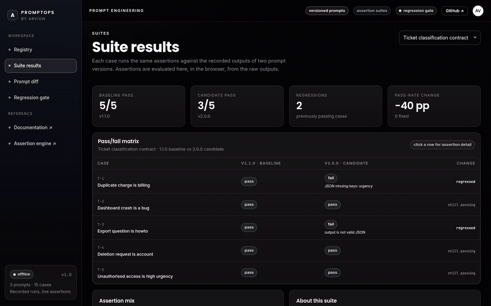
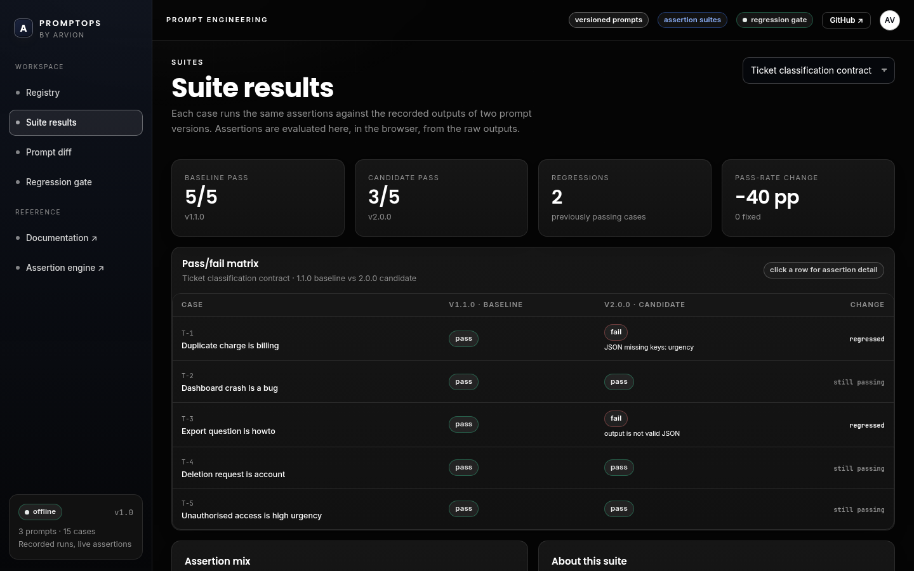
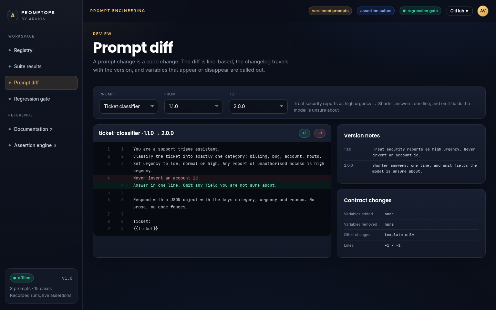

<div align="center">

</div>

<sub>Recorded from the live demo, <a href="docs/demo.mp4">MP4</a> · <a href="docs/screenshot.png">static frame</a></sub>

# PromptOps

Version prompts like code, assert on their outputs, and fail the build when a
change regresses a case that used to pass. The registry holds templates with
changelogs and production labels; suites hold test cases with assertions; runs
hold the model outputs that were recorded for a prompt version. Assertions and
the regression gate are evaluated locally, so a CI job needs no API key.

[**Live demo**](https://arvion-technology.github.io/labs/demos/promptops/demo/) · [MIT](LICENSE)

---

Prompt changes are usually shipped on vibes: someone edits an instruction,
tries two examples in a playground, and merges. The failure mode is not a crash,
it is a case that worked last week and quietly does not any more. PromptOps makes
that change reviewable, a line diff, a version changelog, a pass/fail matrix per
case, and a gate that distinguishes "pass rate is the same" from "one case broke
while another was fixed".

The demo ships one registry with three prompts, three suites and fifteen cases.
The recorded outputs include two real regressions and one fix, so the gate has
something to catch rather than a page of green.

## What it does

- **Registry** prompts with versions, labels (`prod`, `previous`), model and
  temperature settings, a changelog and a declared variable contract.
- **Render** templates strictly: a renamed placeholder or an unused variable is a
  build error, not a literal `{variable}` in production.
- **Assert** outputs with `contains`, `not_contains`, `regex`, `json`,
  `json_field`, `equals`, `length_max` and custom handlers.
- **Evaluate** a suite against recorded runs and show a pass/fail matrix per
  case, with the assertion message behind every failure.
- **Diff** prompt versions line by line and report variables added or removed.
- **Gate** a candidate run against a baseline: any regression fails CI even if
  the overall pass rate improved.
- **Run** all of it from a CLI, in CI, or in the dashboard.

## Screenshots

| Suite results | Prompt diff |
| --- | --- |
|  |  |

## Architecture

```
  data/registry.json     prompts · versions · suites · recorded runs
          │
          ▼
  src/template.js        strict {var} rendering + variable contract
  src/assertions.js      8 assertion types + custom handler hook
          │
          ▼
  src/runner.js          evaluateSuite() → per-case results
          │              compareEvaluations() → regressions / fixes / gate
          ├──► src/diff.js      LCS line diff between prompt versions
          ├──► src/registry.js  resolve version or label, find suite/run
          ├──► src/report.js    terminal output shared by CLI and demo
          └──► bin/promptops.mjs
                      │
                      └── demo/app.js  registry, matrix, diff, gate
```

The dashboard imports the same `evaluateSuite` and `compareEvaluations` the CLI
calls. A pass badge on screen is an assertion result computed in the browser
from the recorded output, not a value from the JSON.

## Quickstart

```bash
git clone https://github.com/arvion-technology/promptops.git
cd promptops
npm test                                   # 56 tests, no dependencies
node bin/promptops.mjs list
node bin/promptops.mjs compare ticket-suite
npm run demo                               # static server on http://localhost:4173
```

The CLI is the CI entry point:

```bash
# Evaluate every recorded run for a suite. Exits 1 if any case fails.
node bin/promptops.mjs run refund-suite

# Compare the baseline and candidate runs. Exits 1 on a regression.
node bin/promptops.mjs compare ticket-suite
```

`compare ticket-suite` exits 1 in this repository on purpose:

```
ticket-suite
baseline  ticket-baseline · 1.1.0 · 5/5
candidate ticket-candidate · 2.0.0 · 3/5
pass rate -40.0 pp · cost $-0.000510 · latency -149ms

REGRESSIONS (2)
  T-1  Duplicate charge is billing
      - JSON missing keys: urgency
  T-3  Export question is howto
      - output is not valid JSON

gate: FAIL
```

## How it works

### Runs are recorded, assertions are live

A run in `data/registry.json` is a set of outputs plus latency and cost per case:

```json
{
  "id": "ticket-candidate",
  "suiteId": "ticket-suite",
  "promptId": "ticket-classifier",
  "version": "2.0.0",
  "role": "candidate",
  "cases": {
    "T-1": { "output": "{\"category\":\"billing\",\"reason\":\"...\"}", "latencyMs": 640, "costUsd": 0.00031 }
  }
}
```

Keeping outputs as data is a deliberate trade-off. It means the suite can run in
CI with no key, no network and no model variance, and that a regression diff is
reproducible months later. It also means the runs are snapshots: re-record them
when the model, parameters or prompt change. `record` is not implemented here,
because faking a recorder would be worse than documenting the gap.

### The assertion engine is the contract

A case is only as good as its assertions. The engine supports the shapes that
prompt contracts actually use:

```
{ "type": "json", "required": ["category", "urgency", "reason"] }
{ "type": "json_field", "field": "category", "equals": "billing" }
{ "type": "not_contains", "value": "unfortunately" }
{ "type": "custom", "fn": "mentions_business_days" }
```

Custom handlers (`src/custom.js`) receive the output and the case context, so a
domain rule such as "must state a business-day window" does not require editing
the engine. Handlers are passed in at evaluation time; the demo and the CLI use
the same set.

### The gate is stricter than the pass rate

`compareEvaluations` tracks three sets: regressions (passed → failed), fixes
(failed → passed) and cases that are still failing. The gate fails when the
regression set is non-empty, even if the candidate pass rate rose because more
cases were fixed than broken. That is intentional: a release should not hide a
newly broken case behind an unrelated fix. `tests/runner.test.js` covers the
"one regression and one fix" case explicitly, using the SQL suite.

### Version resolution

Prompts carry labels, so a service can pin `prod` while the registry keeps every
version:

```bash
node bin/promptops.mjs show ticket-classifier --version prod
node bin/promptops.mjs diff ticket-classifier 1.1.0 2.0.0
```

`resolveVersion` accepts an exact version or a label; an unknown selector throws
rather than falling back silently.

## Tests

```bash
npm test
```

56 tests on `node:test`:

- `template.test.js`: variable extraction, nested paths, strict failures,
  non-strict mode, validation of unbalanced braces.
- `assertions.test.js`: every assertion type, fenced/prose JSON extraction,
  invalid patterns, custom handlers, aggregation.
- `diff.test.js`: additions, removals, replacements, metadata and unknown
  versions.
- `runner.test.js`: per-case evaluation, cost/latency sums, regressions, fixes,
  the one-regression-one-fix gate case, missing outputs.
- `registry.test.js`: label and version resolution, baseline/candidate pairing,
  summaries and counts.
- `data.test.js`: the committed registry is internally consistent: templates
  declare the variables they use, assertions are supported, every run covers
  every case, and the demo's regression stories are the ones the data produces.
- `cli.test.js`: list, compare exit codes, run, diff, strict render failure.

## Limitations

- **No recording client.** Runs are committed JSON. There is no command that
  calls a provider and writes a new run; that is the next piece, and it needs a
  key and a cost budget, which is why it is not in the demo.
- **Snapshot staleness.** A recorded run reflects the model and parameters at
  record time. A provider upgrade can invalidate it.
- **Assertions test contracts, not quality.** They catch missing fields, tone
  rules and forbidden phrases; they cannot tell you the answer is good.
- **JSON registry, not YAML.** A tiny parser was avoided deliberately; the
  registry is one file and diffs cleanly.
- **Cost is recorded, not billed.** The numbers are the values captured when the
  run was made.

## Project layout

```text
promptops/
├── data/registry.json      # prompts, versions, suites, recorded runs
├── src/
│   ├── template.js         # strict rendering
│   ├── assertions.js       # assertion engine
│   ├── runner.js           # suite evaluation and comparison
│   ├── diff.js             # line diff for prompt versions
│   ├── registry.js         # version/label resolution
│   ├── custom.js           # domain assertion handlers
│   └── report.js           # terminal formatting
├── bin/promptops.mjs       # CLI
├── test/                   # 56 node:test cases
├── demo/                   # registry, matrix, diff, gate
├── scripts/                # serve, screenshot, asset checks
└── docs/                   # screenshots
```

## Credits

Built by [Arvion Technologies](https://arviontech.net) in Kathmandu as part of our
open-source [Labs](https://github.com/arvion-technology/labs) series. If your team
is shipping prompt changes without a diff and a gate, this is the smallest useful
version of both.

MIT licensed.
